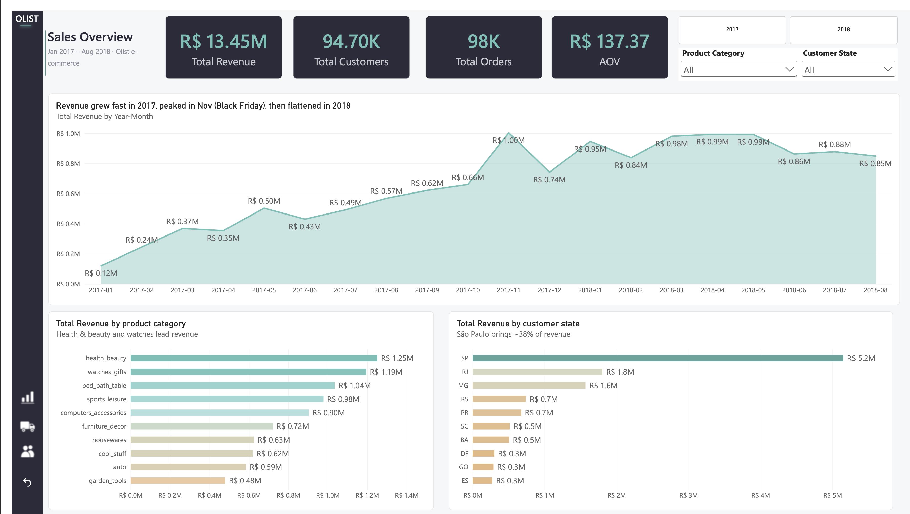
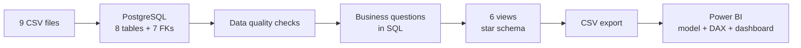
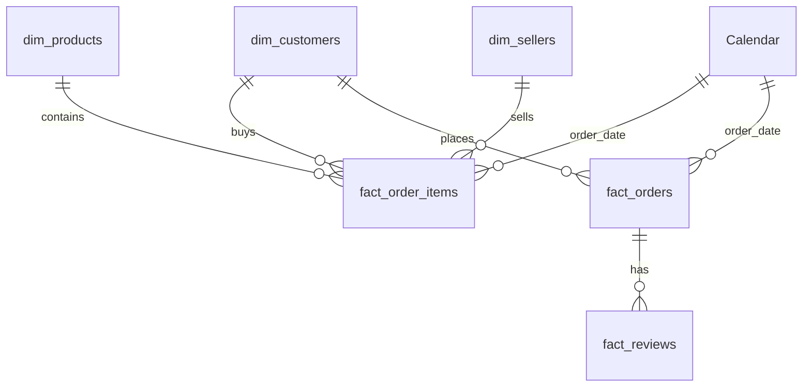
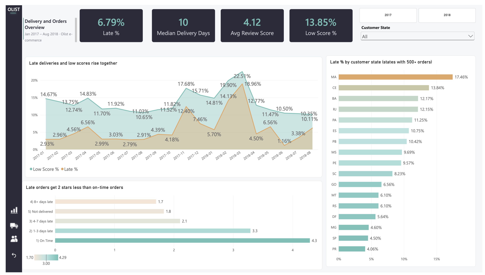
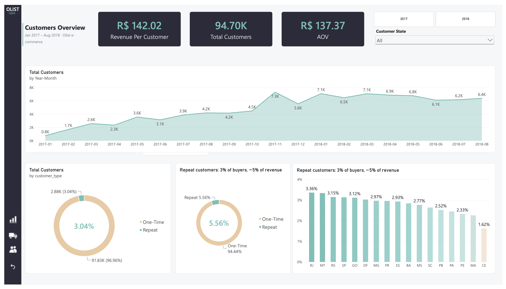

# Olist E-commerce Analysis (SQL + Power BI)

End-to-end analysis of ~100k orders from Olist, a Brazilian online marketplace: from raw CSV files to a PostgreSQL database, business questions answered in SQL, and a 3-page Power BI dashboard.



## Key insights

- **Growth came from new customers, not loyal ones.** Revenue grew fast in 2017 and flattened in 2018 (about R$ 0.85–0.99M per month). Average order value stayed flat (R$ 125–153), and **97% of customers bought only once**.
- **Late deliveries come in waves.** Normally 3–4.5% of orders were late, but this jumped to **12.4% in Nov 2017** (Black Friday) and **19.0% in Mar 2018**. These 3 months contain **about 48% of all late deliveries**.
- **Delays destroy ratings.** On-time orders score **4.29**, late orders score **2.27**. The score drops with every extra day: 4.29 → 3.29 (1–3 days late) → 2.10 (4–7 days) → 1.70 (8+ days).
- **Revenue is concentrated in the Southeast.** São Paulo brings **~38%** of revenue; SP, RJ and MG together bring **~63%**.
- **Delivery problems are regional.** Late delivery rate is highest in the North/Northeast (MA 17.5%, CE 13.8%, BA 12.2%). **RJ** is the biggest problem by volume: 12.1% late and 1,495 late orders.

## Business questions

1. How did orders and revenue change over time?
2. Which product categories and states bring the most revenue?
3. How often are orders delivered late, and where?
4. Are late deliveries linked to low review scores?
5. How many customers come back for a second purchase?
6. *(Bonus)* Do customers whose first order was late come back less often?

## Data

[Brazilian E-Commerce Public Dataset by Olist](https://www.kaggle.com/datasets/olistbr/brazilian-ecommerce) (Kaggle): real, anonymized orders from 2016–2018, split into 9 CSV files (orders, items, payments, reviews, customers, sellers, products, category translation, geolocation). Geolocation was not used.

**Analysis period:** Jan 2017 – Aug 2018. 2016 is almost empty and Sep–Oct 2018 are cut off, so only complete months are used.

**Definitions**

| Term | Definition |
|---|---|
| Revenue | Sum of item `price` (shipping cost excluded) |
| Valid order | Any status except `canceled` and `unavailable` |
| Customer | A real person (`customer_unique_id`), not the per-order `customer_id` |
| Late order | Delivered **after** the estimated date, compared by day (not by time) |
| Low score | Review score of 1 or 2 stars |

## Approach



1. **Load:** created 8 tables with types and primary keys, imported the CSVs, then added 7 foreign keys to check that every reference is valid.
2. **Check quality:** missing values, value ranges, date periods, order statuses, outliers.
3. **Analyze:** answered each business question in SQL (JOINs, CTEs, conditional aggregation, window functions).
4. **Prepare for BI:** built 6 SQL views (3 dimensions + 3 facts) with all business rules applied once, in one place.
5. **Visualize:** Power BI model with a calendar table, 13 DAX measures and 3 report pages. Every key number was checked against the SQL results.

## Data model

Two fact tables share the customer and calendar dimensions (a "galaxy" schema).



| Table | One row = | Notes |
|---|---|---|
| `dim_customers` | one real customer | state and city from the **first** order, total orders, one-time / repeat |
| `dim_products` | one product | English category name, `unknown` if missing |
| `dim_sellers` | one seller | city and state |
| `fact_order_items` | one item in an order | price, freight → revenue, orders, AOV |
| `fact_orders` | one order | delivery days, delay days, delivery status |
| `fact_reviews` | one review | score, review date |

## Data quality findings

- `order_reviews` failed to import in DBeaver because of multi-line comments → loaded with PostgreSQL `\copy`.
- `review_id` is **not unique** (one review can cover several orders) → primary key is `(review_id, order_id)`.
- 2 product categories had no English translation (`pc_gamer`, `portateis_cozinha_e_preparadores_de_alimentos`) → added manually, then the foreign key could be created.
- Products without a category: 1,435 orders and R$ 178.5K (~1.3% of revenue). An INNER JOIN would silently lose this revenue, so a LEFT JOIN + `unknown` label is used.
- 8 delivered orders have no delivery date; 6 canceled orders have one; 5 orders have no items.
- No negative delivery times. Max delivery time is 210 days (strong outlier).

## Detailed findings

### 1. Orders and revenue over time
- Orders grew from 787 in Jan 2017 to 4,547 in Oct 2017.
- **Nov 2017 was the peak:** 7,421 orders (+63% vs October), revenue above R$ 1M for the first time. AOV went *down* (145 → 135), so the spike came from more orders, not bigger orders.
- In 2018 growth stopped: about 6,100–7,200 orders and R$ 0.84–0.99M revenue per month.

### 2. Categories and states
- Top categories by revenue: **health_beauty** (R$ 1.25M) and **watches_gifts** (R$ 1.19M).
- The "best" category depends on the metric: **bed_bath_table** has the most orders (9,394) but low value per order (~R$ 110); **watches_gifts** has fewer orders but ~R$ 213 per order.
- Item prices are right-skewed: median **R$ 74.99** vs average **R$ 120.65**.
- Small remote states have higher revenue per order (~R$ 195–215) than SP (~R$ 126). *Hypothesis:* high shipping costs make people buy mostly expensive items online.

### 3. Delivery
- **6.79%** of delivered orders were late (6,531 of 96,203). Median delivery time is **10 days** (average 12.5).
- Late deliveries are seasonal waves (Nov 2017, Feb–Mar 2018), not a constant problem. In Feb–Mar 2018 order volume did **not** grow, so the cause was likely external.
- Best states: PR 4.1%, SP 4.5%, MG 4.6%. Worst: MA 17.5%, CE 13.8%, BA 12.2%, RJ 12.1%.

### 4. Delivery vs reviews



| Delivery | Avg score | Low scores (1–2★) |
|---|---|---|
| On time | 4.29 | 9.3% |
| 1–3 days late | 3.29 | 32.2% |
| 4–7 days late | 2.10 | 67.7% |
| 8+ days late | 1.70 | 79.2% |
| Not delivered | 1.83 | 75.3% |

The longer the delay, the lower the score (a clear "dose-response" pattern). The biggest drop happens after about 3 days. This is a strong association, but not a formal proof of causation.

### 5. Repeat customers



- About **94.7K** unique customers. **96.96%** bought only once; only **3.04%** came back.
- Repeat customers are 3% of buyers but bring **5.6% of revenue**.
- Retention is low in **every** state (1.6%–3.4%), so it is not a regional problem.

### 6. Bonus: does a late first order reduce repeat purchases?

| First order | Customers | Came back | Return rate |
|---|---|---|---|
| On time | 86,697 | 2,655 | 3.06% |
| Late | 6,343 | 159 | 2.51% |

Late first orders reduce the return rate by ~18% (relative), and a two-proportion z-test gives p ≈ 0.01. But the absolute effect is small: even with perfect delivery, only ~35 more customers would come back. **Delays hurt ratings a lot, but they explain only a small part of the low retention.**

## Recommendations

1. **Plan logistics capacity before peak seasons** (Black Friday). The Nov 2017 spike in orders tripled the late rate.
2. **Fix delivery where it hurts most:** RJ by volume, MA/CE/BA by rate. Investigate what happened in Feb–Mar 2018 with logistics partners.
3. **Keep delays under 3 days** and notify customers early when an order is going to be late: ratings drop sharply after 3 days.
4. **Make retention the main growth lever.** With 97% one-time buyers, even a small increase in second purchases (post-purchase emails, a second-order voucher) would add revenue. Test it with an A/B experiment.
5. **Reduce dependence on the Southeast** by growing other regions, especially where delivery is already reliable (South).
6. **Fill in missing product categories** (~1.3% of revenue is currently "unknown").

## Limitations

- **Observation window:** customers who first bought in mid-2018 had little time to come back, so the real repeat rate may be slightly higher.
- `customer_unique_id` may not capture people who created a new account, which would also understate repeat purchases.
- Customer state is taken from the **first** order, so state-level numbers in Power BI can differ slightly from per-order SQL results.
- The dataset has no information about discounts, marketing or delivery partners, so causes of delays and low retention are hypotheses.

## Tools

- **PostgreSQL 18** (Postgres.app) and **DBeaver**: database, data quality checks, analysis, views
- **SQL:** JOINs, CTEs, `CASE WHEN`, conditional aggregation, window functions (`ROW_NUMBER`, `COUNT/SUM … OVER`)
- **Power BI Desktop:** data model, calendar table, DAX (`CALCULATE`, `DIVIDE`, `DISTINCTCOUNT`, `MEDIAN`, `SWITCH`), conditional formatting, page navigation

## Repository structure

```
olist_project/
├── sql/
│   ├── 01_create_tables.sql   # tables, primary keys
│   ├── 02_foreign_keys.sql    # foreign keys + missing translations
│   ├── 03_data_checks.sql     # data quality checks
│   ├── 04_analysis.sql        # business questions 1–6
│   └── 05_views.sql           # star-schema views for Power BI
├── exports/                   # not included (file size) – generate with
├── powerbi/
│   ├── olist_dashboard.pbix
│   └── olist_dashboard.pdf
├── images/                    # dashboard screenshots
├── findings.md                # working notes
└── README.md
```

Raw Kaggle files are not included (download them from the link above).

## How to reproduce

1. Download the dataset from Kaggle.
2. Create a PostgreSQL database `olist` and run `sql/01_create_tables.sql`.
3. Import the CSV files (use `\copy` for `olist_order_reviews_dataset.csv` because of multi-line comments).
4. Run `02_foreign_keys.sql`, `03_data_checks.sql`, `04_analysis.sql`, then `05_views.sql`.
5. Export the 6 views to CSV (UTF-8) and open `powerbi/olist_dashboard.pbix` (update the file paths in Power Query if needed).

---

**Author:** Rassul Kydyraliyev · [LinkedIn] www.linkedin.com/in/kdrlv · 
